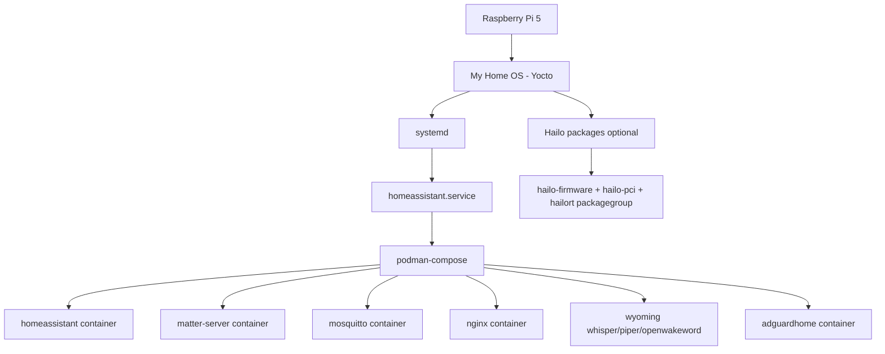

# rpi5-virtual-hailo-yocto

Yocto/KAS project to build a Raspberry Pi 5 operating system focused on:

- Home Assistant as a Podman Compose stack
- Optional Hailo runtime/firmware integration
- A/B rootfs update strategy with SWUpdate and Raspberry Pi tryboot

The project provides a reproducible build flow through a Podman-based build environment and KAS configuration files.

## Purpose

This repository defines a custom distro (`myhome`) and images for a Raspberry Pi 5 target (`raspberrypi5`) where:

- The base OS is built with Yocto (wrynose branch set)
- Home Assistant and companion services run as containers via Podman Compose
- SWUpdate delivers atomic A/B updates and trial boots
- Slot commits are automated after successful boot/service startup

## Initial Requirements

### Host requirements

- Linux host with:
	- Podman installed and working for your user
	- Internet connectivity (to fetch Yocto layers, source tarballs, and container images)
	- Enough disk space for Yocto build caches (`dl`, `sstate`, and build output): recommend at least 150 GB free
	- Enough RAM/CPU for Yocto builds: recommend at least 16 GB RAM and 8 CPU threads

### Repository requirements

- Clone this repository locally
- Execute scripts from the repository root
- Optional: SSH keys in `~/.ssh/` if you need them inside the build container

Notes:

- `podman-env.sh` auto-mounts your `~/.ssh/` into the container if `~/.ssh/id_rsa.pub` exists.
- Downloads and cache directories are shared at repository root (`dl/`, `sstate/`) and reused across builds.

## Repository Layout

- `podman-env.sh`: starts (or builds) the Yocto build container image `yocto-env`
- `build.sh`: KAS wrapper for build, shell, lock update, and custom bitbake commands
- `targets/`: KAS target definitions and source/layer manifests
- `meta-myhome/`: custom distro, image recipes, Home Assistant packaging
- `meta-myhome-rpi/`: Raspberry Pi specific update/boot customization (A/B handling)
- `build_<machine>/`: build output directory generated by `build.sh`

## Build Workflow (Primary Usage)

The expected day-to-day flow uses only:

1. `podman-env.sh` to enter the build environment
2. `build.sh` to run KAS actions

### 1) Enter the build environment

```bash
./podman-env.sh
```

What this script does:

- Checks for image `yocto-env`
- Builds it from `https://github.com/Gmatarrubia/podman-yocto-build.git#wrynose` if missing
- Runs the container with repository bind-mounted to `/yocto`
- Uses `--userns=keep-id` to preserve host UID/GID mapping

You can also pass a command directly:

```bash
./podman-env.sh bash
```

### 2) Build for Raspberry Pi 5

Inside the container (or on host if your environment already has `kas` configured):

```bash
cd /yocto
./build.sh -m rpi5
```

This performs:

- `CONF_FILE=targets/rpi5.yml`
- Build dir: `build_rpi5/`
- Shared downloads/cache: `dl/`, `sstate/`
- `kas build` for default target from the KAS config (`update-image`)

### Useful build options

Open a KAS shell:

```bash
./build.sh -m rpi5 --shell
```

Enable debug override (`targets/features/debug.yml`):

```bash
./build.sh -m rpi5 --debug
```

Run a custom bitbake command:

```bash
./build.sh -m rpi5 -b bitbake swupdate-podman-hass-image -e
```

Refresh KAS lock file for pinned revisions:

```bash
./build.sh -m rpi5 --update
```

## Targets and Configuration

Main target:

- `rpi5` -> `targets/rpi5.yml`
	- includes `targets/myhome.yml`
	- includes `targets/sources/rpi-common.yml`
	- sets machine `raspberrypi5`

Feature includes (from `targets/common.yml`):

- `meta-virtualization`
- `meta-hailo`
- `meta-swupdate`
- `meta-openembedded`
- `meta-yocto`
- `bitbake`
- local layers `meta-myhome` and `meta-myhome-rpi`

Locked commits are maintained in `targets/rpi5.lock.yml`.

## Build Artifacts

Build output root:

- `build_rpi5/tmp/deploy/images/raspberrypi5/`

Expected image/update artifacts (depending on build tasks):

- `swupdate-podman-hass-image-raspberrypi5.rootfs.ext4.gz`
- `swupdate-podman-hass-boot.vfat`
- `update-image-raspberrypi5.swu`
- bootloader/support files (u-boot, env config)

## Final Target Architecture

### High-level runtime view



Home Assistant stack definition is shipped in the image and installed under `/data/homeassistant` on target.

### Boot and update architecture (A/B)

SWUpdate writes to the inactive slot and prepares a trial boot using Raspberry Pi tryboot.

```mermaid
flowchart LR
		U[SWUpdate .swu] --> V{Target slot}
		V -->|copyA| A1[/dev/sda4 rootfs A]
		V -->|copyA| A2[/dev/sda2 boot A]
		V -->|copyB| B1[/dev/sda5 rootfs B]
		V -->|copyB| B2[/dev/sda3 boot B]
		A2 --> T[cmdline root points to /dev/sda4]
		B2 --> T2[cmdline root points to /dev/sda5]
		U --> X[rpi-abctl trial]
		X --> Y[reboot 0 tryboot]
		Y --> Z[rpi-ab-commit.service]
		Z --> Q{homeassistant.service active?}
		Q -->|yes| R[rpi-abctl commit]
		Q -->|no| S[no commit; fallback path remains]
```

### Partition/slot intent

- `boot A`: `/dev/sda2`
- `boot B`: `/dev/sda3`
- `rootfs A`: `/dev/sda4`
- `rootfs B`: `/dev/sda5`
- Selector state stored in `autoboot.txt` (mounted from label `autoboot`)

Core scripts/services involved:

- `rpi-abctl` (`status|prepare|trial|commit`)
- SWUpdate hook `ab-update-hook.sh` (`preinst`, `postinst`)
- `rpi-ab-commit.service` waits for `homeassistant.service` and then commits slot

## Home Assistant Service Lifecycle

`homeassistant.service` executes `homeassistant-ctl.sh`:

1. Checks whether Home Assistant image is already available
2. Pulls images on first startup
3. Runs `podman-compose up -d` from `/data/homeassistant`
4. Reports readiness to systemd (`Type=notify`)

On stop, it executes `podman-compose down`.

## Typical Commands

Start builder shell:

```bash
./podman-env.sh
```

Build default target (`update-image`) for RPi5:

```bash
./build.sh -m rpi5
```

Open interactive build shell:

```bash
./build.sh -m rpi5 --shell
```

Inspect bitbake environment:

```bash
./build.sh -m rpi5 -b bitbake swupdate-podman-hass-image -e
```

Update lock file:

```bash
./build.sh -m rpi5 --update
```

## Troubleshooting

- Error: missing `-m|--machine`
	- Pass a target, for example: `./build.sh -m rpi5`
- Error: unknown machine/config file
	- Ensure the corresponding file exists in `targets/` (for example `targets/rpi5.yml`)
- Container image not found
	- Run `./podman-env.sh`; it auto-builds `yocto-env` if missing
- Very long first build
	- Expected behavior due to toolchain and source downloads

## Notes

- Current lock file pins core layers for reproducible builds (`targets/rpi5.lock.yml`).
- The repository also contains a `qemuarm` target file, but the primary maintained workflow in this project is Raspberry Pi 5 (`-m rpi5`).
